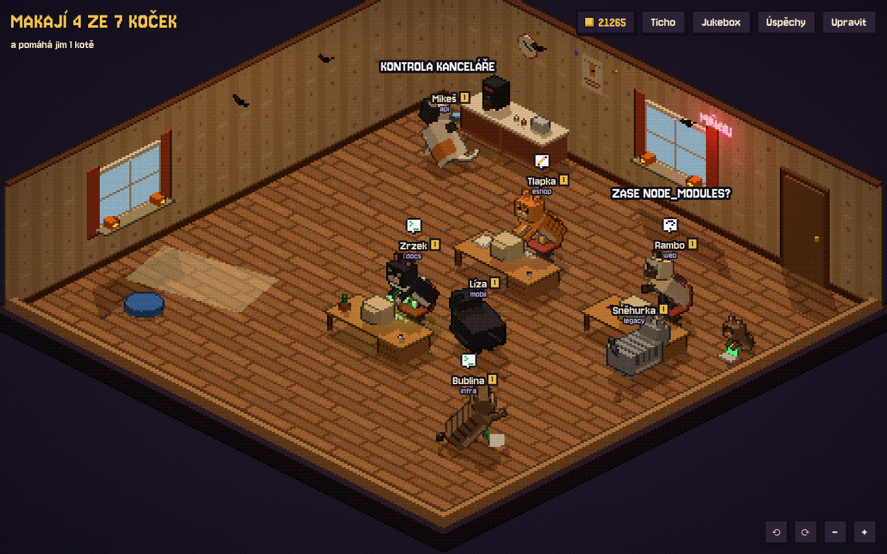

# Cat Office

A live visualization of locally running Claude Code and Codex agents as an isometric 3D office in a retro pixel style. Every session is a voxel cat, subagents are kittens. What a cat does matches what its agent is doing right now.



The game's interface is in Czech; the names of buttons are given below in Czech with an English translation.

## Run with npx

All you need is Node.js 20 or newer, no need to clone the repository:

```sh
npx cat-agents               # office at http://127.0.0.1:4317, opens in the browser by itself
npx cat-agents@latest        # always the latest version
npx cat-agents remove-hooks  # removes Claude and Codex hooks
npx cat-agents install-codex-hooks  # installs Codex hooks without starting the office
npx cat-agents remove-codex-hooks   # removes only Codex hooks
```

Options: `--port <port>`, `--host <host>`, `--data <dir>` (coins, furniture and cats, default `~/.cat-agents`), `--no-hooks` (don't install hooks), `--no-open` (don't open the browser), `--help`. The environment variables listed below work too.

New version on npm: bump `version` in `package.json` and run `npm publish` (the frontend is built automatically before packing).

## From the repository

```sh
npm install
npm run dev                  # Vite at http://localhost:5173, API on :4317
npm run build && npm start   # everything at http://127.0.0.1:4317
```

## Run in Docker

The image is on Docker Hub as `standahorvath/cat-agents` (amd64 and arm64), no need to clone the repository. All you need is Docker (Docker Desktop, OrbStack or Docker Engine). Once it's running, open http://localhost:4317.

Thanks to `--pull always`, the command fetches the latest version every time. It mounts the Claude Code folder read-only (that's how the cats know what the agents are doing), its `settings.json` separately with write access (the hooks go there, see below) and the `cat-agents-data` volume, where coins, furniture and cats survive updates. The file `~/.claude/settings.json` must exist, otherwise Docker would turn it into an empty folder.

### macOS

```sh
docker run -d --pull always --name cat-agents --restart unless-stopped \
  -p 127.0.0.1:4317:4317 \
  -v ~/.claude:/claude:ro \
  -v ~/.claude/settings.json:/claude/settings.json \
  -v cat-agents-data:/app/data \
  standahorvath/cat-agents
```

### Linux

```sh
docker run -d --pull always --name cat-agents --restart unless-stopped \
  -p 127.0.0.1:4317:4317 \
  -v ~/.claude:/claude:ro \
  -v ~/.claude/settings.json:/claude/settings.json \
  -v cat-agents-data:/app/data \
  standahorvath/cat-agents
```

If Docker requires `sudo`, write the full `$HOME` path instead of `~`. With `sudo`, `~` would expand to root's home folder and the cats wouldn't see anything.

### Windows

In PowerShell:

```powershell
docker run -d --pull always --name cat-agents --restart unless-stopped `
  -p 127.0.0.1:4317:4317 `
  -v "$env:USERPROFILE\.claude:/claude:ro" `
  -v "$env:USERPROFILE\.claude\settings.json:/claude/settings.json" `
  -v cat-agents-data:/app/data `
  standahorvath/cat-agents
```

In the command prompt (cmd):

```bat
docker run -d --pull always --name cat-agents --restart unless-stopped ^
  -p 127.0.0.1:4317:4317 ^
  -v "%USERPROFILE%\.claude:/claude:ro" ^
  -v "%USERPROFILE%\.claude\settings.json:/claude/settings.json" ^
  -v cat-agents-data:/app/data ^
  standahorvath/cat-agents
```

If you use Claude Code inside WSL, its folder lives in your Linux home. Run the Linux version of the command directly in the WSL terminal.

### Updating and stopping

The same on every system; coins and furniture stay in the volume:

```sh
docker rm -f cat-agents   # stop and remove the container
# … then run the docker run command for your system again, it pulls the latest version
```

### From the repository

In the project folder this builds the image from source and saves coins to `./data` (the same state as running natively with `npm run dev`, just don't run both at once):

```sh
docker compose up -d --build   # stop with: docker compose down
```

Compose variables: `PORT` (port on the host, default 4317), `CLAUDE_HOME` (a folder other than `~/.claude`), `CLAUDE_STALE_HOURS`, `WEATHER_LAT` and `WEATHER_LON` (weather outside the windows, Prague by default).

New version on Docker Hub: `docker buildx build --platform linux/amd64,linux/arm64 -t standahorvath/cat-agents:<version> -t standahorvath/cat-agents:latest --push .`

### How it works inside

The port is only reachable from this computer. The host's processes aren't visible inside the container, so whether a session is alive isn't checked by PID: Claude deletes `sessions/<pid>.json` when it exits, and a session with no activity for more than 48 h (typically after a crash) is hidden (`CLAUDE_STALE_HOURS`).

## Claude Code hooks

On startup the server adds hooks to `~/.claude/settings.json` by itself (`PreToolUse`, `PostToolUse`, `Notification`, `Stop`, `UserPromptSubmit`, `SubagentStop`). Thanks to them the cats react instantly and notice when an agent is waiting for your permission: the cat runs to the front, waves and meows. A hook only sends the event to `http://127.0.0.1:4317/api/hook`; when the office isn't running, nothing happens and Claude isn't slowed down.

The original file is backed up once to `settings.json.cat-agents.bak`, our entries are recognisable by the `cat-agents` marker and are never duplicated. Removal: `npx cat-agents remove-hooks`, or `npm run hooks:remove` in the repository. Disable installation with the variable `CAT_AGENTS_HOOKS=off` (or `--no-hooks`). The hooks call `curl`, so on Windows they rely on Git Bash, which Claude Code uses.

## Controls

Q / E or the buttons rotate the office by 90°, the mouse wheel or +/− zooms, dragging pans. Hovering over a cat shows its name and project, the Seznam (List) button opens an overview of sessions with their tools and subagents.

Every cat always shows its name above it, with the project below.

The office is square: 10×10 with 4 desks. Desks are only lent to working cats; a cat without a free desk works on a laptop in the lounge. A bigger office is only built with more than 9 sessions.

## Cats and their lives

Every project has its own cat: name, fur, level, needs and clothes persist across sessions (a second session in the same folder gets its own cat). Clicking a cat opens its card with personality, level, needs, mood, relationships, wins, kittens, fur and wardrobe.

- **Levels** grow with time worked (5 min to level 2, 20 min to level 3, 45 min to level 4…).
- **Needs**: food, energy and fun. Work drains them (after 10 minutes of work food is around 50 %, energy around 35 %), slacking off lowers food and fun. They're only refilled by what the cat actually does: eating from a bowl, sleeping in a bed, playing with toys (the browser reports this to the server). When nobody is watching the page, the server refills idle cats itself based on the office's furniture. A happy cat earns up to 1.5×, an unhappy one only half. A hungry cat goes to eat first, a tired one goes to sleep.
- **Context = weight**: the fuller the agent's context, the chubbier the cat and the slower it walks (the card has a Kontext (Context) row). When the context is compacted or the agent runs `/clear`, it slims down. Codex CLI uses the model's reported context window; Claude Code defaults to 1M tokens (set `CLAUDE_CONTEXT_WINDOW` to override it). The cat belongs to the Claude process, so it stays the same after `/clear`.
- **Petting**: on the cat's card you can pet it (refills fun), give it a treat for 10 coins (refills food) or shine a laser for it while it's slacking off.
- **Personalities**: depending on the project, every cat has one of 8 personalities (easygoing, grump, gossip, gamer, cuddler, troublemaker, dandy/diva, nerd). The personality decides what the cat likes to do (the troublemaker knocks mugs off tables and pulls others' tails, the nerd explains code to a rubber duck, the gamer wins at chess) and how it talks.
- **Relationships** (−100 to 100): every pair has its own natural chemistry based on personalities and a bit of chance, so some cats simply don't get along. Shared moments bring them closer or drive them apart, but the closer to ±100, the less each further moment counts, and relationships drift back towards chemistry over hours (they keep changing and never freeze at the maximum). Cats with bad chemistry take nice things with a grain of salt and take nasty ones to heart. Friends have their specialities (secret greeting, hunting together, synchronised dance, inside jokes, whispering, stargazing together, zoomies together), so do rivals (insult rap battle, box war, code review, race to the bowl, tail pulling, keyboard sabotage, knocked-over mug, passive-aggressive note) and petty grievances arise between anyone (a taken bed, stolen kibble, waking someone up, finding someone to blame). When its best friend cuddles with someone else, a cat gets jealous; rivals sometimes make up with a gift. Old saved relationships (version 0.4 and older, which only ever grew) are reset to chemistry once.
- **Games**: chess, tic-tac-toe and cards for two (with a winner and sometimes a flipped chessboard) and group games: hide and seek, tag, tug of war, football (in the garden or in the office), kibble heist (one keeps watch, another creates a distraction, a third steals, sometimes the boss catches them) and a tic-tac-toe tournament. Wins count towards the leaderboard (Úspěchy → Žebříček, Achievements → Leaderboard).
- **Conversations**: besides short lines, cats also hold longer dialogues with a punchline, differently between friends and between rivals.
- **Memes**: OIIA spinning, the cucumber scare, "Cat.exe is not responding", this is fine by the fireplace, a box that's too small, Matrix-style dodging, rubber duck debugging and a contagious crab rave.
- **Rare furs**: silver, gold, cosmic, neon, leopard, spooky and rainbow. They unlock with level and collection and can then be worn by any cat (cat card, Srst (Fur)).
- **Wardrobe**: 19 items for the head, eyes and neck (little hat, top hat, crown, headphones, witch hat, glasses, pixel glasses, monocle, scarf, bow tie, tie, superhero cape, gold chain…), some only from a certain level.
- **Reactions to results**: passing tests = joy, failing tests = bristling, command error = facepalm, commit, push, merge and deploy = confetti. The cat also recognises builds (passed/failed), package installs, lint, deploys, reverts and commands that ran for over 2 minutes. The other cats comment depending on the relationship (a friend cheers, a rival mocks) and a Friday afternoon deploy causes panic.
- **Achievements and collection**: 126 achievements with coin rewards (Night Shift, MERGED!, Mouse Hunter, Soap Opera, Reconciliation, Grandmaster, Perfect Heist, Friday Deploy, Works on My Machine, Crab Rave, Continuous Deployment, Interior Designer, Organised Crime, Hall of Fame…), 10 of them secret, shown only once unlocked, and a collection of 12 things the cats find or win: a caught mouse, a blown fuse, a pizza box, a feather from a visitor, a dust bunny and rare finds like a golden ball of yarn, a shooting star, a four-leaf clover, a lost sock or a rubber duck. A display case in the shop shows off the collection.
- **Sound and jukebox**: a button switches between Hudba + zvuky (Music + sounds), Jen zvuky (Sounds only) and Ticho (Silence, the default). The music is composed on the fly: every track has its own key, mode, chord progressions, tempo, instruments and song structure (intro, verse, chorus, bridge, outro). The melody grows from a motif that repeats, answers itself and varies; the chorus is higher and fuller, the bridge changes chords and rhythm, the last chorus can shift up a step and the outro slows down into the final chord. The drums have fills, cymbals and breaks. It sounds spatial: stereo, reverb, echo and a compressor, tape wobble and vinyl crackle for lo-fi, pumping for synthwave. The Jukebox button shows what's playing (title, style, key, tempo), picks a style (Náhodně (Random), Lo-fi, Jazz, Bossa nova, Chiptune, Synthwave, Ambient) or skips the track. Sounds are short and non-melodic (meowing, purring, hissing, keyboards, fireplace, coins). Everything is synthesised in the browser.
- **Weather and seasons**: the windows show the real weather (Open-Meteo, Prague by default, `WEATHER_LAT`/`WEATHER_LON`, `WEATHER=off`) and the office is decorated for Christmas, Easter, Halloween and Cat Day. To try it: `?season=christmas`, `?weather=snow`, `?hour=23`.
- **Day and night** follow the real time: lamps are on at night, the windows show stars and the moon in its real phase, cats sleep more and gaze at the stars.
- **Random events** roughly once every 3 to 8 minutes: a mouse (cats chase it, whoever catches it gets it in their collection), a power cut (lights go out and monitors go black), a pizza courier (cats gather at the door), a robot vacuum (one cat rides it) and a visit from a stray cat. To try it: `?event=mouse` (`blackout`, `pizza`, `vacuum`, `visitor`).

## Shop and furniture

Working cats earn coins: 1 coin per 10 s of work, a kitten half that. The server counts them, so they're earned even with the page closed, and it saves the state (coins, office size, furniture) to `data/office.json` (`~/.cat-agents/office.json` when run with npx).

The Upravit (Edit) button turns on the grid and the shop with item previews. Click to place the selected item, R rotates, Esc cancels; the preview glows green, or red with the reason why it can't go there (outside the room, in the way, blocking the door, would block a path). Placed items can be dragged to move them, clicked to select and rotate, or sold for half price. Coins also buy a bigger office (13×13, 16×16) and a garden.

Cats only do what the office has furniture for: no sofa, no sleeping on the sofa; no desks, work happens on a laptop. You start with 3 desks, a kitchenette, bowls, a cat bed and 3,500 coins. The shop has 43 items, among them an aquarium, a cat wheel, a hammock, a heated blanket, a retro TV with a console, pinball, a piano, table football, a tunnel, a jukebox, a printer (warm for sleeping on), a cat fountain, a treat vending machine, a cat tree, a ball pit and a display case for the collection, each with its own activities.

**Office looks**: at the bottom of the shop is the Vzhled kanceláře (Office look) section with 9 looks that change the walls, floor, windows, curtains, door, trims, neon and light colour and add their own decorations: Cosy (default), Modern open space, Mountain cabin (skis on the wall), Japanese dojo (lanterns, tatami), Jungle (vines), Halloween (pumpkins, bats), Haunted house (cobwebs, portraits with glowing eyes), Neon city and Space station (blinking consoles). Each can be tried out before buying, a bought one applies right away and switching between bought ones is free.

**The garden** (4,000 coins) is a lawn behind the south wall with a hedge and a door. It has its own garden items (flower bed with butterflies, bird bath, pond, tree, sun lounger, outdoor cat house, garden gnome, lantern) and the cats chase butterflies, stalk birds, roll in the grass and sunbathe there. When it rains or snows they run inside and the garden shows the rain or snow.

## What the cats do

| Agent state | Cat |
| --- | --- |
| Terminal (Bash) | bashes the keyboard at its CRT |
| Writing code | types at its desk |
| Reading / searching | reads in the library or at its desk (with glasses and a book) |
| Web | searches on its phone on a beanbag |
| Subagents | presents at the whiteboard, kittens run over and tap on mini laptops |
| MCP | tunes the server rack (sparks, blinking LEDs) |
| Thinking | paces back and forth, looks out of the window, chases its tail or thinks at its desk |
| Waiting for input | slacks off: coffee, sofa, fireplace, ball of yarn, phone, radio, vending machine, box, knocking off a mug, zoomies, laser, scratching post, garden, memes, games with others… mostly sleeps when tired, more the longer nothing happens, gazes at the stars at night |
| Waiting for permission | runs to the front, waves and shows "!" |
| Session ends | leaves through the door |

The cats also interact with each other (57 interactions and 6 group games): nose boops, grooming, chasing, tug of war, sleeping curled up by the fireplace, gossip, staring contests, sniffing, head rubs, a radio party, a coffee break, hissing, "follow me!", passing a ball of yarn, a paw swipe, sitting tail to tail, a gift of a mouse, a fight at the vending machine, sunbathing together, welcoming a newcomer. Colleagues come over to working cats to give advice (pair programming), bring them coffee or lie down on their keyboard; kittens get a pat.

The lines (over 1,500, in Czech) match what the cat is doing right now: while working it says work lines depending on the tool (refactoring, grepping, works on my machine…), while thinking thinking lines, while sleeping only snoring. Some fit the day and hour (no deploys on Friday, Monday morning, lunch, three in the morning) and every personality has its own.

Windows and light follow the real time of day, the clock on the wall shows the real time.

## Development

- `npm test` runs the rules and content tests (placement, shop, needs, relationships, collection, and that every item has a model, every activity a spot and a pose, every find can be found…)
- `npm run stats` prints how much of everything there is in the game (items, clothes, achievements, lines…), counted straight from the code
- in the demo the office is kept only in memory and starts with 20,000 coins
- `/?demo` made-up sessions cycling through states, `/?demo=idle` all slacking off, `/?demo=work` all working
- `/poses.html` all cat poses side by side (`?only=sit,typing&zoom=2`, `?spin`)
- in development mode the scene is available as `window.__world` (e.g. `__world.cats`, `cat.startActivity('coffee')`)

Code: `server/` reads the state from `~/.claude`, `src/scene/` is the game: `World.js` (renderer, camera, sync), `Office.js` (room, furniture, spots, dynamic objects), `CatModel.js` + `poses.js` (voxel cat and poses), `activities.js` + `Agent.js` (behaviour, movement, lines), `interactions.js` (interactions between cats), `events.js` (random events), `pixelPipeline.js` (low resolution, dithering, outlines), `overlay.js` (name tags, speech bubbles, captions).

## Where the data comes from

### Codex CLI

On macOS, Cat Office starts its bundled Codex adapter and installs observational
hooks into `~/.codex/hooks.json` at startup. Open `/hooks` in Codex CLI to trust
the new definitions. Codex CLI sessions are displayed when their hooks run;
each session disappears on its `SessionEnd` hook or when its hosting process ends. Hook events
sent to the adapter exclude prompt text, tool input, and tool output. The hook
reads the latest numeric token usage from the CLI transcript and sends only the
input-token count and model context window. Transcript format is not a stable
Codex hook API, so context can be unavailable until the next usage record. The adapter
uses a local Unix socket under the Cat Office data directory. Use
`CAT_AGENTS_CODEX=off` to disable it, or
`CAT_AGENTS_HOOKS=off` to skip hook installation. `remove-hooks` removes both
Claude and Codex hooks.

The bundled adapter scans macOS processes, so Codex sessions are not collected
when Cat Office runs inside the Linux Docker image. The optional
`PUT /api/external-sources/codex/sessions` endpoint remains available for
external adapters; it requires `CAT_AGENTS_EXTERNAL_TOKEN` and loopback access.
See the [snapshot protocol](docs/codex-adapter.md).

Every second the server reads `~/.claude` (or `$CLAUDE_CONFIG_DIR`) and sends changes over SSE to `/api/events`:

- `sessions/<pid>.json`: running sessions and their `busy` / `idle` status; the process is checked to be alive
- `projects/<project>/<sessionId>.jsonl`: the transcript; the latest `tool_use` / `tool_result` tell the current tool, `usage` the context size and `compact_boundary` a compaction
- `projects/<project>/<sessionId>/subagents/*.jsonl` + `.meta.json`: subagents and their description

This is not a documented Claude Code API, so the format may change with a new version. The server listens on `127.0.0.1` only.

## License

[MIT](LICENSE)
